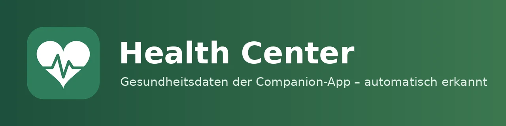

| [🇩🇪<br>**Deutsch**](README.md) | 🇬🇧<br>**English** | [🇳🇱<br>**Nederlands**](README.nl.md) |
|:-:|:-:|:-:|



# Health Center 0.0.1

📖 Blog post: [meinesmartewelt.de](https://meinesmartewelt.de) (German)

Health Center automatically detects which health sensors you enabled in the Home Assistant Companion App (Android: Health Connect, iOS: Health), assigns them to user profiles and shows them in a dashboard card styled after Samsung Health.

## Features

- Automatic detection of Companion App sensors (steps, distance, floors, energy, active minutes, sleep with stages, heart rate, resting heart rate, HRV, VO₂ max, …), tolerant of different sensor names.
- Automatic assignment to profiles via the person entity (`user_id`); can be changed manually (administrator).
- Card tabs: Overview (rings + tiles), Activity, Sleep (stage chart), Heart (24 h trend), Statistics (7/30/90 days), Settings.
- Own daily history with recorder backfill; daily goals per profile; event when a goal is reached.
- Privacy: non-administrators only see their own profile (can be turned off).
- Languages: German, English, Dutch.

## New in 0.0.1

First version. Everything is new; see [EXPERIMENTELL.md](EXPERIMENTELL.md) (German) for untested extra features.

## Images

No screenshots yet, because the card has so far only been checked in a browser with test data.

## Requirements

- Home Assistant 2025.6 or newer
- Home Assistant Companion App with health sensors enabled (Settings → Companion App → Sensors)
- Person entities linked to a user

## Installation

**HACS:** add the custom repository `https://github.com/meine-smarte-welt/health_center` (category Integration), install, restart Home Assistant.

**Manual:** copy the folder `custom_components/health_center` to `config/custom_components/` and restart.

## Setup

Settings → Devices & services → Add integration → “Health Center”. On dashboards in storage mode the card is registered as a resource automatically. In YAML mode add the resource `/health_center_files/health-center-card.js?v=0.0.1` (JavaScript module) manually.

## The card

```yaml
type: custom:health-center-card
title: Health Center
default_tab: overview
show_sleep: true
zoom: 1
read_only: false
```

Each category has a switch `show_<category>` (`overview`, `activity`, `sleep`, `heart`, `body`, `stats`, `settings`). `profile` pins a profile (person entity). The “Body” tab only appears with the experimental features.

## Colors

| Key | Meaning |
|---|---|
| `color_tab_active` | active tab |
| `color_success` / `color_warning` / `color_error` / `color_info` | status colors |
| `color_row_icon` | all icons |
| `color_live_banner` | banner |
| `color_steps` / `color_energy` / `color_exercise` / `color_sleep` / `color_heart` | charts |
| `color_icon_<category>` | icon color per tab |

Allowed: hex, `rgb()`, `hsl()` and `var(--…)`.

## Services

| Service | Purpose |
|---|---|
| `health_center.rescan` | search sensors and assignment again (administrator) |
| `health_center.set_goal` | set a profile's daily goal (administrator) |
| `health_center.assign_device` | assign a device to a person (administrator) |

## Events

`health_center_goal_reached`, `health_center_sensor_detected`, `health_center_sensor_lost`, `health_center_profile_added` (can be turned off in the options; no event flood at startup).

## Sensors

Number of profiles, number of detected sensors and the daily goal progress per profile.

## Version display and update notice

The version is shown in the card (cog → App version), at the top of the card editor and in the options dialog. GitHub is checked for a newer version every 12 hours. Update via HACS, restart Home Assistant, reload the browser (Ctrl+F5).

## Settings

Options (Configure): all profiles visible to everyone, send events, import history (days), default goals, experimental features.

## Security

Write actions are administrator-only, input is validated in the backend, texts in the card are escaped, colors use an allowlist. **Note:** the Companion App sensors themselves are visible to all users in Home Assistant; Health Center only restricts the card. History queries (`details`) only work for visible profiles.

## Known limitations

- **Untested:** not tested on real Android/iOS devices, only with a simulated Home Assistant (8 automated tests) and a browser check with test data.
- Sensor names are partly assumed; detection is tolerant and matches name parts.
- The format of sleep stage attributes is untested; without stages the card shows totals only.
- Recorder backfill is untested.
- The mobile app sometimes reports values only on change or with delay.
- No medical assessment; sleep score and trend hints are guide values.
- The Lovelace resource is only registered automatically in storage mode.

## Troubleshooting

- Card shows “No Companion App found”: sign in to the app, enable sensors, use “Rescan sensors” in the cog tab.
- Empty profile: the person entity must be linked to the user, or assign the device manually in the cog tab.
- Card does not load: clear the browser cache (Ctrl+F5).

## Version history

| Version | Change |
|---|---|
| **0.0.1** | First version |

## File integrity

SHA-256 of the JSON files. The `.py`, `.js` and `.yaml` files carry their hash in the first line (`tail -n +2 file | sha256sum`).

| Datei | SHA-256 |
|---|---|
| `custom_components/health_center/icons.json` | `0eff86dff91d31975f01248b8e9741579a6555e0a1e9ac9bf550c5c538879b18` |
| `custom_components/health_center/manifest.json` | `ca5c51341458279f688139bf5f87ac4457a26976aa6488e22bb2ee2cea44ca5c` |
| `custom_components/health_center/strings.json` | `477d7270031864eb2a133dc6f250dc8d2dc5cf1d5d63f330079bef0b760b8260` |
| `custom_components/health_center/translations/de.json` | `477d7270031864eb2a133dc6f250dc8d2dc5cf1d5d63f330079bef0b760b8260` |
| `custom_components/health_center/translations/en.json` | `1c14951fe35af542ad04142b19852651948221998be6cd68a9e9b8eac62f1882` |
| `custom_components/health_center/translations/nl.json` | `64dc7f0e412b65c830d01f5071e6e84893f141d329d31edbb38bc9bce5f807a8` |

## License

MIT, see [LICENSE](LICENSE).

