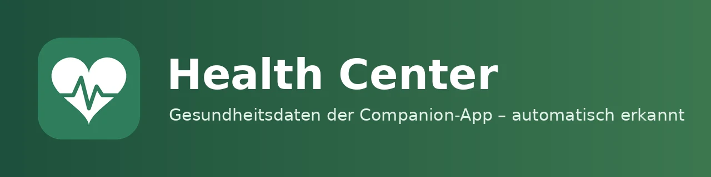

| 🇩🇪<br>**Deutsch** | [🇬🇧<br>**English**](README.en.md) | [🇳🇱<br>**Nederlands**](README.nl.md) |
|:-:|:-:|:-:|



# Health Center 0.0.1

📖 Blogbeitrag: [meinesmartewelt.de](https://meinesmartewelt.de)

Health Center erkennt automatisch, welche Gesundheitssensoren Du in der Home-Assistant-Companion-App (Android: Health Connect, iOS: Health) aktiviert hast, ordnet sie den Benutzerprofilen zu und zeigt sie in einer Dashboard-Karte im Stil von Samsung Health.

## Funktionsumfang

- Automatische Erkennung der Companion-App-Sensoren (Schritte, Distanz, Etagen, Energie, Aktivminuten, Schlaf mit Phasen, Herzfrequenz, Ruhepuls, HRV, VO₂max u. a.), tolerant gegenüber verschiedenen Sensornamen.
- Automatische Zuordnung zu Profilen über die Person-Entität (`user_id`); manuell änderbar (Administrator).
- Karte mit Tabs: Übersicht (Ringe + Kacheln), Aktivität, Schlaf (Phasen-Diagramm), Herz (24-h-Verlauf), Statistik (7/30/90 Tage), Einstellungen.
- Eigener Tagesverlauf mit Nachladen aus dem Recorder; Tagesziele je Profil; Ereignis bei erreichtem Ziel.
- Datenschutz: Nicht-Administratoren sehen nur ihr eigenes Profil (abschaltbar).
- Mehrsprachig: Deutsch, Englisch, Niederländisch.

## Neu in 0.0.1

Erste Version. Alle Funktionen sind neu; siehe [EXPERIMENTELL.md](EXPERIMENTELL.md) für ungeprüfte Zusatzfunktionen.

## Bilder

Es liegen noch keine Screenshots bei, da die Karte bisher nur mit Testdaten im Browser geprüft wurde.

## Voraussetzungen

- Home Assistant 2025.6 oder neuer
- Home-Assistant-Companion-App mit aktivierten Gesundheitssensoren (Einstellungen → Companion-App → Sensoren)
- Person-Entitäten mit verknüpftem Benutzer

## Installation

**HACS:** Benutzerdefiniertes Repository `https://github.com/meine-smarte-welt/health_center` (Kategorie Integration) hinzufügen, installieren, Home Assistant neu starten.

**Manuell:** Ordner `custom_components/health_center` nach `config/custom_components/` kopieren und neu starten.

## Einrichtung

Einstellungen → Geräte & Dienste → Integration hinzufügen → „Health Center“. Die Karte wird bei Dashboards im Speichermodus automatisch als Ressource eingetragen. Im YAML-Modus: Ressource `/health_center_files/health-center-card.js?v=0.0.1` (Typ JavaScript-Modul) manuell eintragen.

## Die Karte

```yaml
type: custom:health-center-card
title: Health Center
default_tab: overview
show_sleep: true
zoom: 1
read_only: false
```

Jede Kategorie hat einen Schalter `show_<kategorie>` (`overview`, `activity`, `sleep`, `heart`, `body`, `stats`, `settings`). `profile` legt ein festes Profil fest (Person-Entität). Der Tab „Körper“ erscheint nur mit den experimentellen Funktionen.

## Farben

| Schlüssel | Bedeutung |
|---|---|
| `color_tab_active` | aktiver Tab |
| `color_success` / `color_warning` / `color_error` / `color_info` | Statusfarben |
| `color_row_icon` | alle Symbole |
| `color_live_banner` | Banner |
| `color_steps` / `color_energy` / `color_exercise` / `color_sleep` / `color_heart` | Diagramme |
| `color_icon_<kategorie>` | Symbolfarbe je Tab |

Erlaubt sind Hex, `rgb()`, `hsl()` und `var(--…)`.

## Services

| Service | Zweck |
|---|---|
| `health_center.rescan` | Sensoren und Zuordnung neu suchen (Administrator) |
| `health_center.set_goal` | Tagesziel eines Profils setzen (Administrator) |
| `health_center.assign_device` | Gerät einer Person zuordnen (Administrator) |

## Ereignisse

`health_center_goal_reached`, `health_center_sensor_detected`, `health_center_sensor_lost`, `health_center_profile_added` (in den Optionen abschaltbar; beim Start entsteht keine Ereignisflut).

## Sensoren

Anzahl Profile, Anzahl erkannter Sensoren und je Profil der Tagesziel-Fortschritt.

## Versionsanzeige und Update-Hinweis

Die Version steht in der Karte (Zahnrad → App-Version), oben im Karten-Editor und im Optionen-Dialog. Alle 12 Stunden wird GitHub nach einer neueren Version gefragt. Update über HACS, Home Assistant neu starten, Browser neu laden (Strg+F5).

## Einstellungen

Optionen (Konfigurieren): alle Profile für alle sichtbar, Ereignisse senden, Verlauf nachladen (Tage), Standardziele, experimentelle Funktionen.

## Sicherheit

Schreibende Aktionen nur für Administratoren, Eingaben werden im Backend geprüft, Texte in der Karte maskiert, Farben nur per Allowlist. **Hinweis:** Die Companion-App-Sensoren selbst sind in Home Assistant für alle Benutzer sichtbar; Health Center beschränkt nur die Karte. Der Verlaufsabruf (`details`) ist nur für sichtbare Profile möglich.

## Bekannte Einschränkungen

- **Ungeprüft:** Die Integration wurde nicht an echten Android-/iOS-Geräten getestet, nur mit simuliertem Home Assistant (8 automatisierte Tests) und einer Browser-Prüfung mit Testdaten.
- Sensornamen sind teils vermutet; erkannt wird tolerant über Namensteile.
- Format der Schlafphasen-Attribute ist ungeprüft; ohne Phasen zeigt die Karte nur Summen.
- Nachladen aus dem Recorder ist ungeprüft.
- Die Mobile-App meldet Werte teils nur bei Änderung oder zeitverzögert.
- Keine medizinische Bewertung; Schlafwert und Trend-Hinweise sind Richtwerte.
- Lovelace-Ressource wird nur im Speichermodus automatisch eingetragen.

## Fehlerbehebung

- Karte zeigt „Keine Companion-App gefunden“: In der App anmelden, Sensoren aktivieren, im Zahnrad „Sensoren neu suchen“.
- Profil leer: Person-Entität muss mit dem Benutzer verknüpft sein, oder Gerät im Zahnrad manuell zuordnen.
- Karte lädt nicht: Browser-Cache leeren (Strg+F5).

## Versionshistorie

| Version | Änderung |
|---|---|
| **0.0.1** | Erste Version |

## Datei-Integrität

SHA-256 der JSON-Dateien. Die Dateien `.py`, `.js`, `.yaml` tragen den Hash in der ersten Zeile (`tail -n +2 datei | sha256sum`).

| Datei | SHA-256 |
|---|---|
| `custom_components/health_center/icons.json` | `0eff86dff91d31975f01248b8e9741579a6555e0a1e9ac9bf550c5c538879b18` |
| `custom_components/health_center/manifest.json` | `ca5c51341458279f688139bf5f87ac4457a26976aa6488e22bb2ee2cea44ca5c` |
| `custom_components/health_center/strings.json` | `477d7270031864eb2a133dc6f250dc8d2dc5cf1d5d63f330079bef0b760b8260` |
| `custom_components/health_center/translations/de.json` | `477d7270031864eb2a133dc6f250dc8d2dc5cf1d5d63f330079bef0b760b8260` |
| `custom_components/health_center/translations/en.json` | `1c14951fe35af542ad04142b19852651948221998be6cd68a9e9b8eac62f1882` |
| `custom_components/health_center/translations/nl.json` | `64dc7f0e412b65c830d01f5071e6e84893f141d329d31edbb38bc9bce5f807a8` |

## Lizenz

MIT, siehe [LICENSE](LICENSE).

