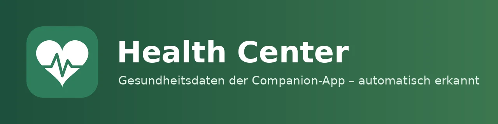

| [🇩🇪<br>**Deutsch**](README.md) | [🇬🇧<br>**English**](README.en.md) | 🇳🇱<br>**Nederlands** |
|:-:|:-:|:-:|



# Health Center 0.0.1

📖 Blogbericht: [meinesmartewelt.de](https://meinesmartewelt.de) (Duits)

Health Center herkent automatisch welke gezondheidssensoren je in de Home Assistant Companion-app hebt ingeschakeld (Android: Health Connect, iOS: Health), koppelt ze aan gebruikersprofielen en toont ze in een dashboardkaart in de stijl van Samsung Health.

## Functies

- Automatische herkenning van Companion-app-sensoren (stappen, afstand, verdiepingen, energie, actieve minuten, slaap met fasen, hartslag, rusthartslag, HRV, VO₂max, …), tolerant voor verschillende sensornamen.
- Automatische toewijzing aan profielen via de persoon-entiteit (`user_id`); handmatig te wijzigen (beheerder).
- Kaarttabs: Overzicht (ringen + tegels), Activiteit, Slaap (fasendiagram), Hart (24-uursverloop), Statistieken (7/30/90 dagen), Instellingen.
- Eigen dagverloop met aanvulling uit de recorder; dagdoelen per profiel; gebeurtenis bij bereikt doel.
- Privacy: niet-beheerders zien alleen hun eigen profiel (uit te zetten).
- Talen: Duits, Engels, Nederlands.

## Nieuw in 0.0.1

Eerste versie. Alles is nieuw; zie [EXPERIMENTELL.md](EXPERIMENTELL.md) (Duits) voor onggeteste extra functies.

## Afbeeldingen

Er zijn nog geen screenshots, omdat de kaart tot nu toe alleen met testgegevens in een browser is gecontroleerd.

## Vereisten

- Home Assistant 2025.6 of nieuwer
- Home Assistant Companion-app met ingeschakelde gezondheidssensoren (Instellingen → Companion-app → Sensoren)
- Persoon-entiteiten gekoppeld aan een gebruiker

## Installatie

**HACS:** voeg de aangepaste repository `https://github.com/meine-smarte-welt/health_center` toe (categorie Integratie), installeer en herstart Home Assistant.

**Handmatig:** kopieer de map `custom_components/health_center` naar `config/custom_components/` en herstart.

## Instellen

Instellingen → Apparaten en diensten → Integratie toevoegen → “Health Center”. Bij dashboards in opslagmodus wordt de kaart automatisch als resource geregistreerd. In YAML-modus voeg je de resource `/health_center_files/health-center-card.js?v=0.0.1` (JavaScript-module) handmatig toe.

## De kaart

```yaml
type: custom:health-center-card
title: Health Center
default_tab: overview
show_sleep: true
zoom: 1
read_only: false
```

Elke categorie heeft een schakelaar `show_<categorie>` (`overview`, `activity`, `sleep`, `heart`, `body`, `stats`, `settings`). `profile` legt een profiel vast (persoon-entiteit). Het tabblad “Lichaam” verschijnt alleen met de experimentele functies.

## Kleuren

| Sleutel | Betekenis |
|---|---|
| `color_tab_active` | actief tabblad |
| `color_success` / `color_warning` / `color_error` / `color_info` | statuskleuren |
| `color_row_icon` | alle pictogrammen |
| `color_live_banner` | banner |
| `color_steps` / `color_energy` / `color_exercise` / `color_sleep` / `color_heart` | diagrammen |
| `color_icon_<categorie>` | pictogramkleur per tabblad |

Toegestaan: hex, `rgb()`, `hsl()` en `var(--…)`.

## Services

| Service | Doel |
|---|---|
| `health_center.rescan` | sensoren en toewijzing opnieuw zoeken (beheerder) |
| `health_center.set_goal` | dagdoel van een profiel instellen (beheerder) |
| `health_center.assign_device` | apparaat aan een persoon toewijzen (beheerder) |

## Gebeurtenissen

`health_center_goal_reached`, `health_center_sensor_detected`, `health_center_sensor_lost`, `health_center_profile_added` (uit te zetten in de opties; geen gebeurtenissenvloed bij het starten).

## Sensoren

Aantal profielen, aantal herkende sensoren en de voortgang van het dagdoel per profiel.

## Versieweergave en updatemelding

De versie staat in de kaart (tandwiel → App-versie), bovenaan de kaarteditor en in het optiesdialoogvenster. Elke 12 uur wordt GitHub gecontroleerd op een nieuwere versie. Update via HACS, herstart Home Assistant, laad de browser opnieuw (Ctrl+F5).

## Instellingen

Opties (Configureren): alle profielen voor iedereen zichtbaar, gebeurtenissen verzenden, geschiedenis importeren (dagen), standaarddoelen, experimentele functies.

## Beveiliging

Schrijfacties alleen voor beheerders, invoer wordt in de backend gecontroleerd, teksten in de kaart worden ge-escaped, kleuren via een allowlist. **Let op:** de Companion-app-sensoren zelf zijn in Home Assistant voor alle gebruikers zichtbaar; Health Center beperkt alleen de kaart. Geschiedenisopvragen (`details`) werken alleen voor zichtbare profielen.

## Bekende beperkingen

- **Ongetest:** niet getest op echte Android-/iOS-apparaten, alleen met een gesimuleerde Home Assistant (8 geautomatiseerde tests) en een browsercontrole met testgegevens.
- Sensornamen zijn deels aangenomen; herkenning is tolerant en gebruikt naamdelen.
- Het formaat van slaapfase-attributen is ongetest; zonder fasen toont de kaart alleen totalen.
- Aanvullen uit de recorder is ongetest.
- De mobiele app meldt waarden soms alleen bij wijziging of met vertraging.
- Geen medische beoordeling; slaapscore en trendhints zijn richtwaarden.
- De Lovelace-resource wordt alleen in opslagmodus automatisch geregistreerd.

## Probleemoplossing

- Kaart toont “Geen Companion-app gevonden”: log in bij de app, schakel sensoren in, gebruik “Sensoren opnieuw zoeken” in het tandwiel-tabblad.
- Leeg profiel: de persoon-entiteit moet aan de gebruiker gekoppeld zijn, of wijs het apparaat handmatig toe.
- Kaart laadt niet: wis de browsercache (Ctrl+F5).

## Versiegeschiedenis

| Versie | Wijziging |
|---|---|
| **0.0.1** | Eerste versie |

## Bestandsintegriteit

SHA-256 van de JSON-bestanden. De bestanden `.py`, `.js` en `.yaml` dragen hun hash in de eerste regel (`tail -n +2 bestand | sha256sum`).

| Datei | SHA-256 |
|---|---|
| `custom_components/health_center/icons.json` | `0eff86dff91d31975f01248b8e9741579a6555e0a1e9ac9bf550c5c538879b18` |
| `custom_components/health_center/manifest.json` | `ca5c51341458279f688139bf5f87ac4457a26976aa6488e22bb2ee2cea44ca5c` |
| `custom_components/health_center/strings.json` | `477d7270031864eb2a133dc6f250dc8d2dc5cf1d5d63f330079bef0b760b8260` |
| `custom_components/health_center/translations/de.json` | `477d7270031864eb2a133dc6f250dc8d2dc5cf1d5d63f330079bef0b760b8260` |
| `custom_components/health_center/translations/en.json` | `1c14951fe35af542ad04142b19852651948221998be6cd68a9e9b8eac62f1882` |
| `custom_components/health_center/translations/nl.json` | `64dc7f0e412b65c830d01f5071e6e84893f141d329d31edbb38bc9bce5f807a8` |

## Licentie

MIT, zie [LICENSE](LICENSE).

